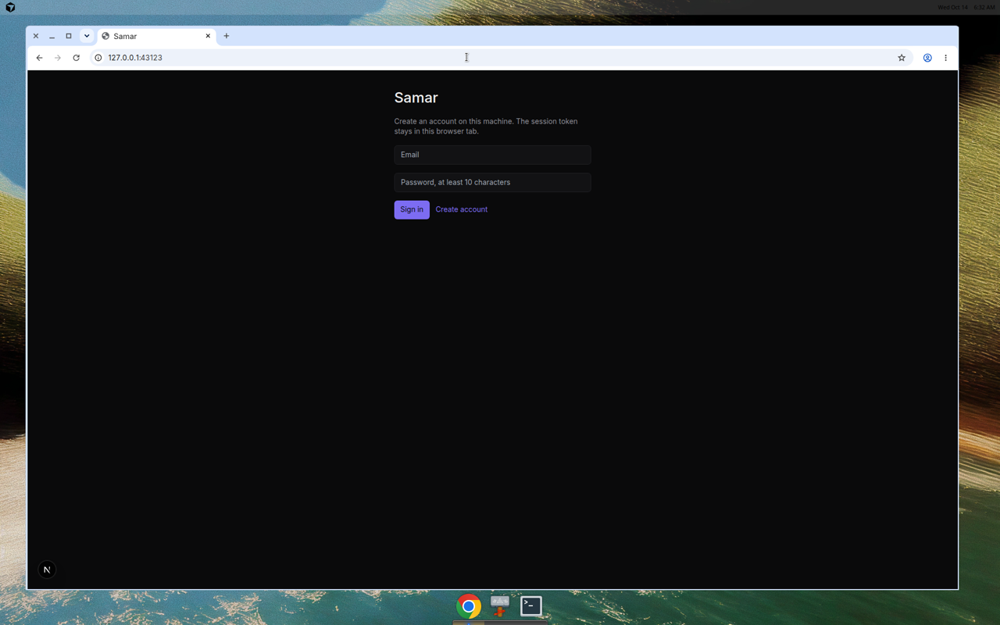
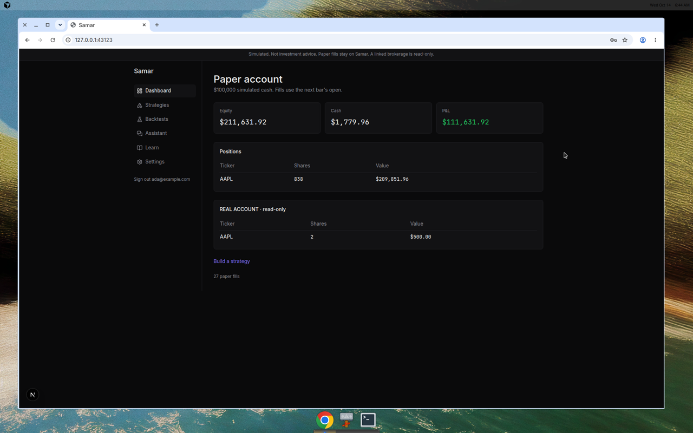
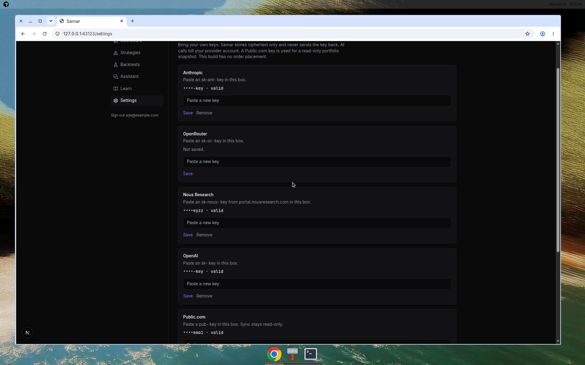
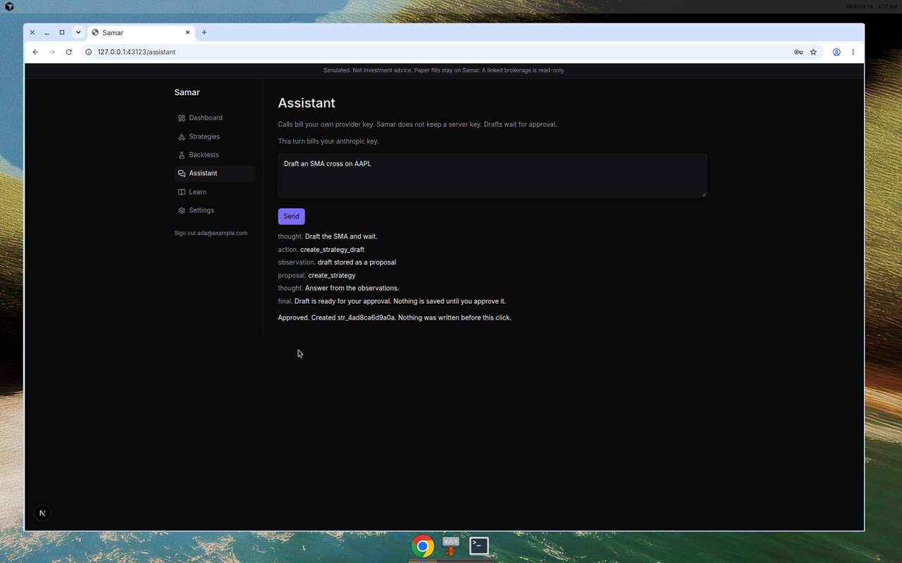
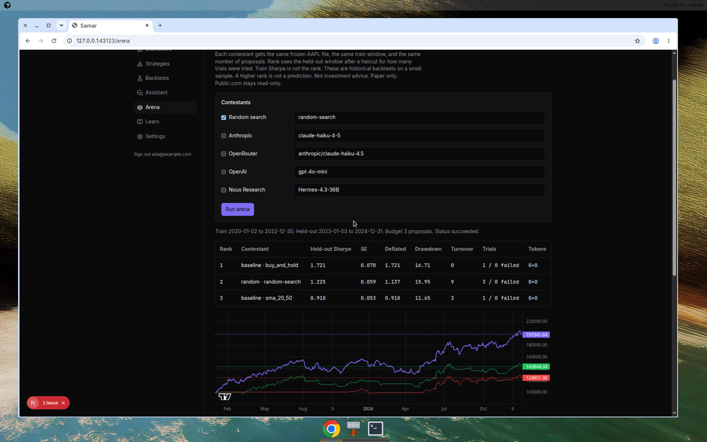
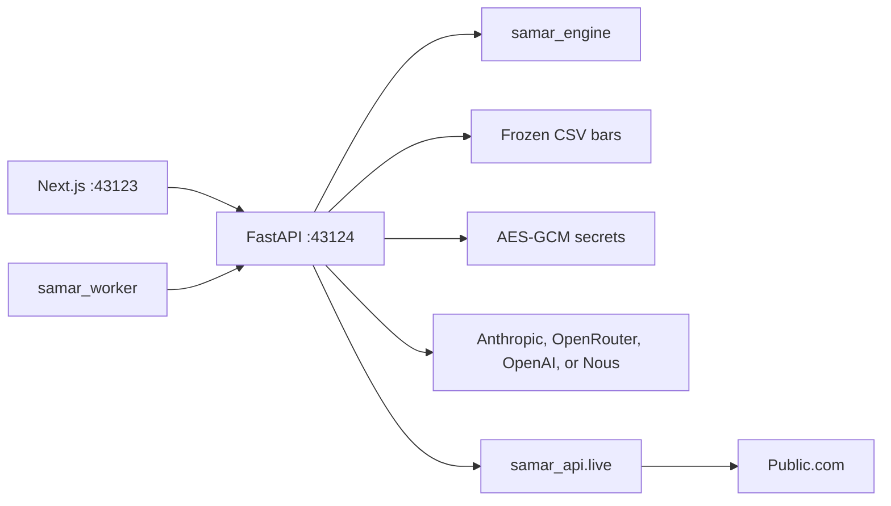
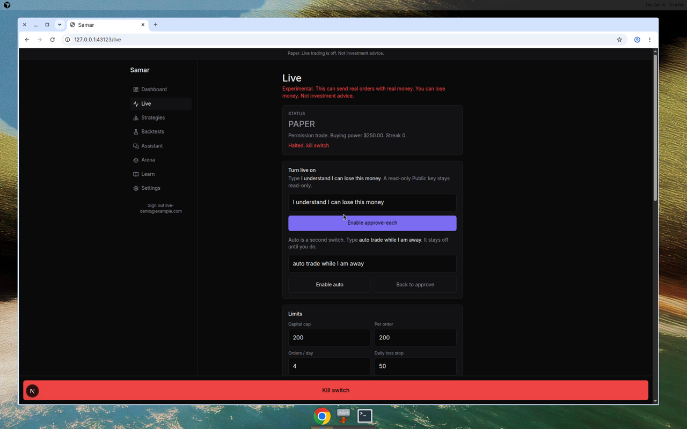

# Samar

Practice a strategy on paper. Build a rule, backtest it against a frozen daily history, and paper-trade the version you are willing to watch. Nothing here is investment advice.

Live trading is off. It can send real Public.com orders and you can lose money. It is experimental. Turn it on only from the Live page, with the exact confirmation phrases, after a Public key shows trade permission.

## Run

```bash
uv sync --all-packages --group dev
pnpm install
uv run python -m samar_api
pnpm --filter web dev
uv run python -m samar_worker
```

The site is [http://127.0.0.1:43123](http://127.0.0.1:43123). The API is [http://127.0.0.1:43124](http://127.0.0.1:43124). Create an account on the first screen. The session token stays in the browser tab. The worker is the process that keeps auto mode running after you close the browser. `SAMAR_WORKER_SECONDS` defaults to 60.

`make verify` runs the lint, type, import boundary, secret scan, and behavior tests. That is the same command CI runs.

Set `SAMAR_KEK` to 64 hex characters before anyone else can open the database. An empty value uses a fixed development key and prints a warning. Set `SAMAR_ENV` to `production`, or any name other than `dev`, `development`, `local`, or `test`, and a missing or development key stops the process. Set `SAMAR_SUPABASE_URL` and `SAMAR_SUPABASE_ANON_KEY` to check Supabase access tokens instead of the local account table.

## A session

1. Create an account. Another account cannot read your strategies, keys, or paper fills.
2. Open Strategies and start from the SMA cross template. Run the 2020–2024 backtest. The chart is the strategy against SPY. The panel under it compares the rule with holding the same ticker and prints the Sharpe standard error.
3. Paper-trade that run. An order on bar t fills at bar t+1's open, then 5 basis points of adverse slippage. Evaluating the same day again inserts no second fill.
4. Settings stores each key as ciphertext and shows the last four characters. With no model key, the assistant uses a local script. With a key, the turn is sent to that provider. If more than one model key is saved, the Assistant model section picks the provider and model id. A strategy is written only after you approve the proposal.
5. Sync portfolio reads the first Public.com account and shows the holdings on the dashboard under "REAL ACCOUNT · read-only". That sync does not place orders.
6. Live stays paper until you type `I understand I can lose this money`. Auto mode stays off until you type `auto trade while I am away`. The worker then runs the selected strategy or model during the regular session and submits through the same limits. The phone Live page is the kill switch.

## Screens












The sync and assistant frames were captured with the API pointed at a local stub, because this environment has no provider keys. Leave `SAMAR_ANTHROPIC_URL`, `SAMAR_OPENROUTER_URL`, `SAMAR_OPENAI_URL`, `SAMAR_NOUS_URL`, `SAMAR_PUBLIC_AUTH_URL`, and `SAMAR_PUBLIC_GATEWAY` unset and the process calls Anthropic, OpenRouter, OpenAI, Nous, and Public.com.

## Key setup

Paste each secret into the matching box on Settings. Samar never sends the key back.

| Settings box | What to paste | Where the call goes |
| --- | --- | --- |
| Anthropic | A key that starts with `sk-ant-` | `https://api.anthropic.com/v1/messages` |
| OpenRouter | A key that starts with `sk-or-` | `https://openrouter.ai/api/v1/chat/completions` |
| Nous Research | A key that starts with `sk-nous-`, created at [portal.nousresearch.com](https://portal.nousresearch.com) | `https://inference-api.nousresearch.com/v1/chat/completions` |
| OpenAI | A key that starts with `sk-` | `https://api.openai.com/v1/chat/completions` |
| Public.com | A key that starts with `pub-` | Read path for sync. Live orders only after the Live page confirmation, and only if the account reports `tradePermissions` `BUY_AND_SELL`. Anything else stays read-only. |

Default models are `claude-haiku-4-5`, `anthropic/claude-haiku-4.5`, `Hermes-4.3-36B`, and `gpt-4o-mini`. The Nous id is the one in Nous Portal's OpenAPI example. Change it in Assistant model after two model keys are saved.

## Architecture



`packages/engine` is pure. It cannot import HTTP, the clock, or the market adapter. `packages/data` reads the frozen Yahoo chart CSVs. `apps/worker` claims one queued backtest and, when auto mode is on, runs one live cycle. It does not import the order client. `supabase/migrations/0001_init.sql` is the Postgres row-level security contract. The process you start locally uses sqlite. Live tables are sqlite only.

## What the tests lock

The SMA 20/50 rule on the frozen AAPL file, 2020-01-02 through 2024-12-31, returns 111.63%, CAGR 16.19%, Sharpe 0.84, 13 round trips, p-value 0.0596. Buy-and-hold of those bars is 236.76%. A paper buy in the API test fills 9000 shares at 10.005 and marks the position at the last close, so equity is 99955.0. A second eval inserts 0. A mocked Public.com sync returns account `acc-1`, equity 1200.5, and 2 AAPL. The read paths are the token exchange, the account list, and the portfolio read. A mocked live buy of 1 AAPL at 20 posts the limit body with `useMargin` false, and a second approve of the same order id posts nothing.

## Security

You bring the keys. Samar does not ship a model key or a brokerage key. Each secret has its own data key, wrapped by `SAMAR_KEK`. Associated data is `user_id|kind`, so a ciphertext cannot be moved to another row. See [DISCLAIMER.md](DISCLAIMER.md) and [SECURITY.md](SECURITY.md).

## Model arena

Arena compares saved providers on one frozen AAPL file. Search sees 2020-01-02 through 2022-12-30 only. The rank is the held-out Sharpe from 2023-01-03 through 2024-12-31, minus a haircut of `sharpe_se * sqrt(2 * ln(trials))`. Walk-forward fold Sharpes are reported and are not the rank. Baselines are buy-and-hold and the SMA 20/50 rule. Random search is the seeded control. Each contestant gets the same proposal budget, the same token cap, the same spec schema, and the same 5 basis points of slippage.

Save a provider key in Settings, open Arena, pick the contestants, and run. The run is one job. Posting the same contestants again returns the same run. A model that returns an invalid spec records a failure and still spends a trial. The result is a historical backtest on a small sample. It is not a prediction and it is not advice.

## Honest limits

This build is not deployed. Supabase Auth is used when the two environment variables are set. Otherwise accounts live in sqlite. The Postgres policies are checked as text and have not been applied to a database. Paper is still the default. Live orders use Public's `orderId` as the idempotency key. Official docs do not show a separate client order id, and they do not show a read-only key scope. A missing `tradePermissions` value is treated as read-only. Cancel on the kill switch covers orders Samar recorded. A list-all-open-orders endpoint was not in the docs used for this build.

## Live

You can lose money. This is not investment advice.

1. Save a `pub-` key on Settings.
2. Open Live and type `I understand I can lose this money`. The key must report `BUY_AND_SELL`. Mode 1 approves each ticket. Tickets expire after 5 minutes.
3. For auto mode, type `auto trade while I am away`, pick a saved strategy or a model, and leave `uv run python -m samar_worker` running. The browser can close. The worker does nothing when the market is closed, when the source is off, or when a limit fails.
4. Limits default to a $200 capital cap, $200 per order, 4 orders a day, 2 orders a minute for each model, and a $50 daily loss stop. Blank or Unlimited on orders per day removes only that count. The capital cap cannot be saved above buying power. Buys are limit orders for whole shares of the allowlist, cash only, regular hours. No options, crypto, margin, or shorts. A stock sale settles the next business day. Samar will not spend those unsettled proceeds on a buy. Public's cash-only buying power is `buyingPower.cashOnlyBuyingPower` when the portfolio returns it. The old $25,000 pattern-day-trader minimum does not apply to this cash path. Public says that designation ended for margin accounts on June 4, 2026.
5. Kill switch, a broker error, three broker rejections, an unexpected position, or the loss stop turn live mode off and cancel recorded open orders.


